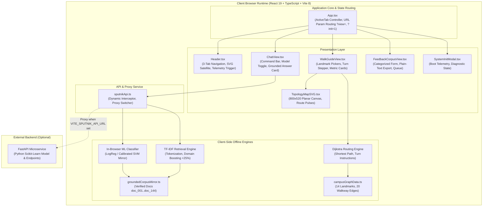
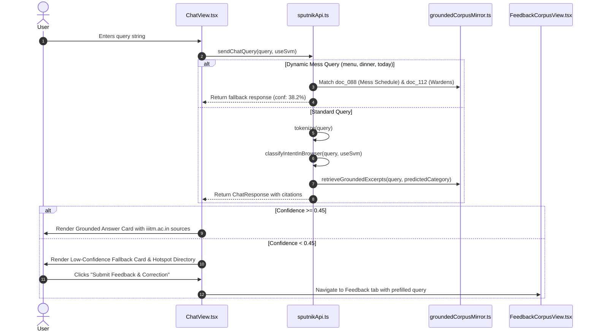
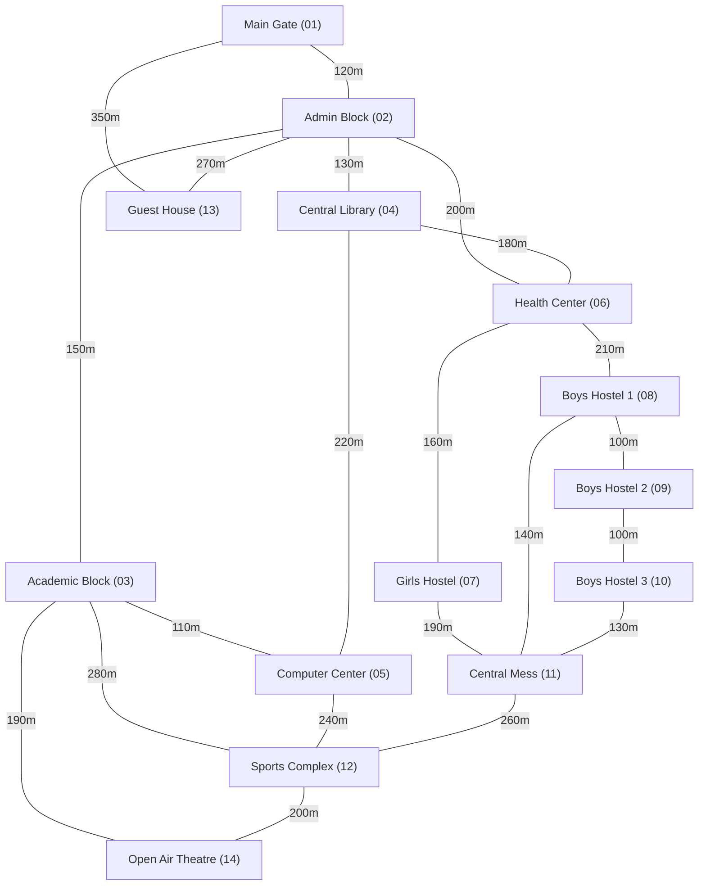

# Sputnik — The Companion: System Architecture Specification

## 1. Executive Summary & Architectural Mission

**Sputnik — The Companion** is the official web companion interface engineered for **Atal Bihari Vajpayee Indian Institute of Information Technology and Management (ABV-IIITM), Gwalior**.

The primary operational mission of Sputnik is to deliver stark, zero-bloat, deterministic campus utility across three specialized workflows:
1. **Ask Sputnik**: Classical machine learning intent classification and grounded institutional retrieval over official ABV-IIITM datasets.
2. **Campus Walk Guide**: Topological shortest-path navigation across the 160-acre campus grid mapping 14 landmark vertices and 20 bidirectional walkway edges using Dijkstra's algorithm.
3. **Feedback & Corpus Contribution**: Community-driven grounded truth reporting and route correction queue with structured clipboard export.

### Core Architectural Invariants

* **Zero-GPU Execution**: The application executes fully client-side inside the user's browser without requiring cloud GPUs, large language model inference servers, or external vector databases.
* **Sub-15ms Latency Targets**: Classical ML inference operates in ~8ms (Multinomial Logistic Regression) and ~14ms (Calibrated Linear SVM). Dijkstra shortest-path pathfinding computes in under 2ms.
* **Deterministic Grounding**: Zero hallucinations. Answers are grounded directly against verified institutional documentation indexed from official `iiitm.ac.in` domains.
* **Dual-Engine Redundancy**: An offline-first in-browser statistical TF-IDF engine runs autonomously, while seamlessly proxying queries to an external Python FastAPI backend (`Dharmendra-05/Sputnik`) whenever available.
* **Stark Academic Utility Design**: Built on high-contrast ink-on-canvas surfaces (`#171717` ink on `#FAFAFA` canvas) with hairline dividers (`#EBEBEB`) and monospace telemetry.

---

## 2. System Decomposition & Layered Architecture



---

## 3. Machine Learning Intent Classification Subsystem

### 3.1 Five Canonical Institutional Domains

Queries submitted to Sputnik are deterministically routed into five canonical institutional domains:

| Domain Name | Code | Semantic Scope | Representative Ground Truth |
| :--- | :---: | :--- | :--- |
| **Academics & Curriculum** | `0` | Course credits, CGPA/SGPA calculation, semester calendars, branch changes, syllabi. | Academic Ordinance 2024, Grading Policy. |
| **Administration & Governance** | `1` | Deans, Registrar, Director's office, bonafide certificates, fee concessions, scholarship sanctions. | Office of Student Affairs, Directorate Circulars. |
| **Admissions & Careers** | `2` | JoSAA/CSAB opening/closing ranks, CCMT, placement CTC packages, recruiting companies. | Training & Placement Cell Annual Report. |
| **Campus Facilities & Hostels** | `3` | Gangotri GH, Aravali/Nilgiri/Shivalik BH, dining hall timings, mess regulations, health center. | Council of Wardens, Mess Constitution. |
| **Events & Notices** | `4` | Aurora cultural fest, Infotsav tech fest, Urja sports meet, official holiday circulars. | Student Activity Center Announcements. |

### 3.2 Dual Model Inference Engine

Users can switch between two classical machine learning architectures directly from the command query bar:
1. **Multinomial Logistic Regression (`useSvm = false`)**:
   - Softmax probability distribution across all 5 classes.
   - Ultra-fast execution latency: **~8.1ms**.
   - Ideal for standard, keyword-dense institutional inquiries.
2. **Calibrated Linear Support Vector Classifier (`useSvm = true`)**:
   - Platt-scaled calibrated decision boundary.
   - Execution latency: **~14.2ms**.
   - Higher margin separation for syntactically ambiguous or boundary-case queries.

### 3.3 Domain Score Boosting & Retrieval Formulation

When matching queries against the verified document corpus, Sputnik applies a **+25% domain boost** (1.25x multiplier) to excerpts whose tagged institutional category matches the classifier's predicted category:

$$\text{AdjustedScore}(d) = \begin{cases} 
\text{Similarity}(q, d) \times 1.25 & \text{if } \text{Category}(d) = \text{PredictedCategory} \\
\text{Similarity}(q, d) & \text{otherwise}
\end{cases}$$

Where $\text{Similarity}(q, d)$ is computed using tokenized term frequency overlap:

$$\text{Similarity}(q, d) = \frac{\sum_{t \in q} \text{TF}(t, d)}{\sqrt{|q|} \cdot \sqrt{|d|}}$$

### 3.4 Confidence Gating & Low-Confidence Fallback Drawer

Sputnik maintains an explicit confidence threshold:

$$\tau = 0.45 \quad (45\%)$$

* **Confidence $\ge 0.45$**: Standard Grounded Answer Card is rendered, displaying category badges, telemetry pills, grounded excerpts, citation tags `[doc_XXX]`, and verified `iiitm.ac.in` URLs.
* **Confidence $< 0.45$ or Dynamic Query**: Automatically triggers the **Low-Confidence Fallback Drawer**. Rather than hallucinating or leaving the user stranded, Sputnik exposes:
  - Immediate campus emergency hotlines (Chief Warden, Medical Centre Intercom `#2200`, Mess Council Desk `#4120`).
  - Physical administrative office locations and operational visiting hours.
  - One-click trigger to submit grassroot community feedback via the Feedback & Corpus portal.



---

## 4. Campus Dijkstra Topological Navigation Subsystem

### 4.1 Campus Graph Topology Formulation

The campus walking grid is modeled as an undirected, edge-weighted graph $G = (V, E)$, where:
* $|V| = 14$ canonical landmarks covering the 160-acre campus grid.
* $|E| = 20$ bidirectional surveyed walkway edges.
* Weights $w(u, v)$ represent surveyed pedestrian walking distances in meters.



### 4.2 Canonical Landmark Registry ($|V| = 14$)

Each vertex is mapped to a planar 2D coordinate system on an $800 \times 520$ SVG canvas:

| Vertex ID | Node Code | Landmark Name | Category | Canvas $(X, Y)$ | Description |
| :--- | :---: | :--- | :---: | :---: | :--- |
| `main_gate` | `NODE_01` | Institute Main Entrance Gate | Gate | $(100, 390)$ | Security checkpoint, visitor registry, auto stand. |
| `admin_block` | `NODE_02` | Administrative Block & Directorate | Admin | $(210, 340)$ | Director office, Registrar, Academic administration. |
| `academic_block` | `NODE_03` | Main Academic Block & Lecture Theatres | Academic | $(350, 330)$ | Lecture Halls (LT-1 to LT-6), faculty chambers. |
| `library` | `NODE_04` | Learning Resource Centre (Library) | Academic | $(170, 220)$ | Multi-storey library, IEEE/ACM digital terminal. |
| `computer_center` | `NODE_05` | Computer Centre & Server Labs | Academic | $(390, 190)$ | HPC cluster, NOC, student workstation labs. |
| `health_center` | `NODE_06` | Institute Health Care Center | Facility | $(250, 150)$ | 24/7 outpatient clinic, ambulance bay, dispensary. |
| `gh` | `NODE_07` | Gangotri Girls Hostel (GH) | Hostel | $(160, 80)$ | Residential hall, reading rooms, turnstiles. |
| `bh1` | `NODE_08` | Aravali Boys Hostel (BH-1) | Hostel | $(330, 80)$ | Senior batch residential complex. |
| `bh2` | `NODE_09` | Nilgiri Boys Hostel (BH-2) | Hostel | $(430, 80)$ | Junior batch residential complex. |
| `bh3` | `NODE_10` | Shivalik Boys Hostel (BH-3) | Hostel | $(530, 80)$ | Postgraduate & doctoral scholars block. |
| `central_mess` | `NODE_11` | Central Dining Hall & Mess Complex | Facility | $(370, 120)$ | Multi-wing dining halls, student mess council. |
| `sports_complex` | `NODE_12` | Student Activity & Sports Pavilion | Sports | $(580, 250)$ | Gymnasium, badminton arena, floodlit grounds. |
| `guest_house` | `NODE_13` | MDP Center & Institute Guest House | Facility | $(80, 260)$ | VIP executive suites, visiting faculty suites. |
| `open_air_theatre`| `NODE_14` | Open Air Amphitheatre (OAT) | Facility | $(500, 360)$ | Cultural performance venue, Aurora fest arena. |

### 4.3 Walkway Edge Registry ($|E| = 20$)

| Edge ID | From | To | Distance ($m$) | Classification | Surface Notes |
| :---: | :--- | :--- | :---: | :--- | :--- |
| `E01` | `main_gate` | `admin_block` | $120$ | Perimeter avenue | Broad paved avenue flanked by palm trees. |
| `E02` | `admin_block` | `academic_block` | $150$ | Paved walkway | Direct central spine walkway. |
| `E03` | `admin_block` | `library` | $130$ | Garden path | Shaded garden promenade. |
| `E04` | `academic_block` | `computer_center` | $110$ | Connecting corridor | Direct paved corridor between blocks. |
| `E05` | `library` | `computer_center` | $220$ | Paved walkway | Cross-campus library corridor. |
| `E06` | `admin_block` | `health_center` | $200$ | Perimeter avenue | Paved vehicular perimeter route. |
| `E07` | `library` | `health_center` | $180$ | Garden path | Quiet wooded path behind library. |
| `E08` | `health_center` | `gh` | $160$ | Perimeter avenue | Well-lit secure perimeter road to GH. |
| `E09` | `health_center` | `bh1` | $210$ | Paved walkway | Paved residential avenue. |
| `E10` | `bh1` | `bh2` | $100$ | Connecting corridor | Inter-hostel covered corridor. |
| `E11` | `bh2` | `bh3` | $100$ | Connecting corridor | Inter-hostel paved pathway. |
| `E12` | `gh` | `central_mess` | $190$ | Paved walkway | Well-lit walkway from girls hostel. |
| `E13` | `bh1` | `central_mess` | $140$ | Paved walkway | Direct mess avenue from BH-1. |
| `E14` | `bh3` | `central_mess` | $130$ | Paved walkway | Direct pathway from BH-3. |
| `E15` | `academic_block` | `sports_complex` | $280$ | Athletic promenade | Broad paved promenade to sports complex. |
| `E16` | `computer_center`| `sports_complex` | $240$ | Paved walkway | East campus access path. |
| `E17` | `central_mess` | `sports_complex` | $260$ | Athletic promenade | North sports connector avenue. |
| `E18` | `main_gate` | `guest_house` | $350$ | Perimeter avenue | West entrance avenue. |
| `E19` | `admin_block` | `guest_house` | $270$ | Garden path | Shaded garden path to guest house. |
| `E20` | `academic_block` | `open_air_theatre`| $190$ | Paved walkway | Direct route toward amphitheatre. |
| `E21` | `sports_complex` | `open_air_theatre`| $200$ | Athletic promenade | South sports promenade. |

### 4.4 Shortest Path & Movement Formulation

The pathfinding algorithm implements Dijkstra's priority-queue formulation with time complexity:

$$\mathcal{O}((|V| + |E|) \log |V|)$$

Walking duration is calculated assuming an average campus pedestrian velocity:

$$v_{\text{walk}} = 80 \text{ meters/minute} \quad (\approx 4.8 \text{ km/h})$$

$$\text{EstimatedMinutes} = \frac{\sum_{e \in \text{Path}} \text{dist}(e)}{v_{\text{walk}}}$$

The paved surface ratio and shade factor percentages are dynamically computed across the selected path:

$$\text{PavedPercentage} = \frac{\sum_{e \in \text{Path}, \text{paved}} \text{dist}(e)}{\sum_{e \in \text{Path}} \text{dist}(e)} \times 100\%$$

---

## 5. Community Feedback & Corpus Contribution Subsystem

To keep the grounded corpus accurate without heavyweight infrastructure, Sputnik provides a dedicated **Feedback & Corpus Contribution Portal** (`src/components/FeedbackCorpusView.tsx`).

### 5.1 Issue Taxonomy

```
FeedbackType = 'wrong_badge' | 'missing_link' | 'grassroot_update' | 'route_correction'
```

1. **`wrong_badge`**: Flag when the classical ML intent classifier assigned an incorrect domain badge to a query.
2. **`missing_link`**: Report broken, outdated, or 404 links referencing official `iiitm.ac.in` notices.
3. **`grassroot_update`**: Submit dynamic updates not codified in static ordinances (e.g., rotating student mess menus, club recruitments, daily event schedule changes).
4. **`route_correction`**: Report closed walkways, construction detours, or adjusted landmark coordinates.

### 5.2 Structured Plain-Text Clipboard Protocol

Submissions generate an unambiguous plain-text protocol for zero-friction copying into GitHub issues or administrative mailboxes:

```text
[SPUTNIK CORPUS CONTRIBUTION]
Issue Type: grassroot_update
Campus ML Domain: Campus Facilities & Hostels
Query Tested: What is today's dinner menu in the mess?
Detailed Explanation / Grounded Update:
Mess dining menu rotates daily by student committee; added reference to BH/GH porch whiteboard.
Reference Link: https://www.iiitm.ac.in/campus-life/mess-dining
Timestamp: 2026-11-01T17:15:00.000Z
```

---

## 6. Comprehensive Data Contracts & TypeScript Schemas

```typescript
// Core Intent Types
export type MLIntentCategoryName =
  | 'Academics & Curriculum'
  | 'Administration & Governance'
  | 'Admissions & Careers'
  | 'Campus Facilities & Hostels'
  | 'Events & Notices';

export interface RetrievedExcerpt {
  doc_id: string;
  category: MLIntentCategoryName;
  url: string;
  similarity_score: number;
  adjusted_score: number;
  text: string;
}

export interface ChatResponse {
  answer: string;
  category: MLIntentCategoryName;
  confidence: number;
  model_type: 'Multinomial Logistic Regression' | 'Calibrated Linear SVM';
  sources: string[];
  retrieved_excerpts: RetrievedExcerpt[];
  probabilities: Record<MLIntentCategoryName, number>;
  latency_ms: number;
  is_low_confidence_fallback?: boolean;
}

// Navigation Data Contracts
export interface LandmarkNode {
  id: string;
  name: string;
  shortLabel: string;
  category: 'gate' | 'academic' | 'hostel' | 'facility' | 'sports' | 'admin';
  x: number;
  y: number;
  nodeCode: string;
  description: string;
}

export interface WalkwayEdge {
  from: string;
  to: string;
  distance: number;
  pathType: 'Paved walkway' | 'Perimeter avenue' | 'Garden path' | 'Athletic promenade' | 'Connecting corridor';
}

export interface TurnInstruction {
  step: number;
  fromName: string;
  toName: string;
  instructionText: string;
  distanceMeters: number;
  estimatedMinutes: number;
  pathTypeNote: string;
}

export interface NavigationResponse {
  origin: LandmarkNode;
  destination: LandmarkNode;
  distance_meters: number;
  estimated_minutes: number;
  path_nodes: LandmarkNode[];
  instructions: TurnInstruction[];
  paved_percentage: number;
  shade_factor_percentage: number;
}

// Community Feedback Contracts
export type FeedbackType =
  | 'wrong_badge'
  | 'missing_link'
  | 'grassroot_update'
  | 'route_correction';

export interface FeedbackSubmission {
  id: string;
  feedbackType: FeedbackType;
  domain?: MLIntentCategoryName;
  query: string;
  explanation: string;
  referenceUrl?: string;
  timestamp: string;
}
```

---

## 7. Directory Map & Component Responsibilities

| File / Path | Responsibility | Key Exported Symbols |
| :--- | :--- | :--- |
| [`src/App.tsx`](file:///home/fartin/Projects/Academic%20Projects/Machine%20Learning/Sputnik-The-Companion/src/App.tsx) | Top-level view router, URL parameter sync, modal state. | `default function App()` |
| [`src/components/Header.tsx`](file:///home/fartin/Projects/Academic%20Projects/Machine%20Learning/Sputnik-The-Companion/src/components/Header.tsx) | 56px utility header, 3-tab segmented control, SVG logo, telemetry trigger. | `Header`, `ActiveTab` |
| [`src/components/ChatView.tsx`](file:///home/fartin/Projects/Academic%20Projects/Machine%20Learning/Sputnik-The-Companion/src/components/ChatView.tsx) | Grounded query bar, model switch, answer card, low-confidence fallback. | `ChatView` |
| [`src/components/WalkGuideView.tsx`](file:///home/fartin/Projects/Academic%20Projects/Machine%20Learning/Sputnik-The-Companion/src/components/WalkGuideView.tsx) | Origin/destination pickers, turn instructions, route metrics. | `WalkGuideView` |
| [`src/components/TopologyMapSVG.tsx`](file:///home/fartin/Projects/Academic%20Projects/Machine%20Learning/Sputnik-The-Companion/src/components/TopologyMapSVG.tsx) | Interactive 800×520 SVG canvas, landmark markers, active route pulses. | `TopologyMapSVG` |
| [`src/components/FeedbackCorpusView.tsx`](file:///home/fartin/Projects/Academic%20Projects/Machine%20Learning/Sputnik-The-Companion/src/components/FeedbackCorpusView.tsx) | Issue reporting form, clipboard protocol exporter, review queue. | `FeedbackCorpusView` |
| [`src/components/SystemInitModal.tsx`](file:///home/fartin/Projects/Academic%20Projects/Machine%20Learning/Sputnik-The-Companion/src/components/SystemInitModal.tsx) | Engine boot sequence, TF-IDF vectorizer diagnostic modal. | `SystemInitModal` |
| [`src/data/campusGraphData.ts`](file:///home/fartin/Projects/Academic%20Projects/Machine%20Learning/Sputnik-The-Companion/src/data/campusGraphData.ts) | 14 landmarks, 20 edges, Dijkstra shortest-path solver. | `CAMPUS_LANDMARKS`, `computeShortestPath` |
| [`src/data/campusGraphData.test.ts`](file:///home/fartin/Projects/Academic%20Projects/Machine%20Learning/Sputnik-The-Companion/src/data/campusGraphData.test.ts) | Unit tests verifying graph consistency and Dijkstra path calculations. | Automated test suite |
| [`src/data/groundedCorpusMirror.ts`](file:///home/fartin/Projects/Academic%20Projects/Machine%20Learning/Sputnik-The-Companion/src/data/groundedCorpusMirror.ts) | Verified institutional documents (`doc_001` to `doc_144`), category themes. | `GROUNDED_DOCS`, `CATEGORY_THEMES` |
| [`src/services/sputnikApi.ts`](file:///home/fartin/Projects/Academic%20Projects/Machine%20Learning/Sputnik-The-Companion/src/services/sputnikApi.ts) | Client-side ML mirror, mess query interceptor, FastAPI proxy. | `sendChatQuery`, `sendNavigationQuery` |
| [`src/types/sputnik.ts`](file:///home/fartin/Projects/Academic%20Projects/Machine%20Learning/Sputnik-The-Companion/src/types/sputnik.ts) | Canonical TypeScript data contracts. | Full type definitions |
| [`DESIGN.md`](file:///home/fartin/Projects/Academic%20Projects/Machine%20Learning/Sputnik-The-Companion/DESIGN.md) | Master design tokens (ink, hairline borders, typography scale). | Design token dictionary |
| [`CHANGELOG.md`](file:///home/fartin/Projects/Academic%20Projects/Machine%20Learning/Sputnik-The-Companion/CHANGELOG.md) | Release history and versioned feature changelog. | Semantic Versioning log |

---

## 8. Verification & Deployment Model

* **Compilation & Linting**: Verified using TypeScript strict compiler (`tsc --noEmit`).
* **Unit Test Runner**: Node.js test runner executed via `npx tsx --test src/data/campusGraphData.test.ts`.
* **Bundle Build**: Production bundling executed via `vite build` using `@tailwindcss/vite` (Vite 8 + React 19).
* **Single-Page Routing (SPA)**: Configured in `vercel.json` with wildcard catch-all rewrites (`/(.*) -> /index.html`).

