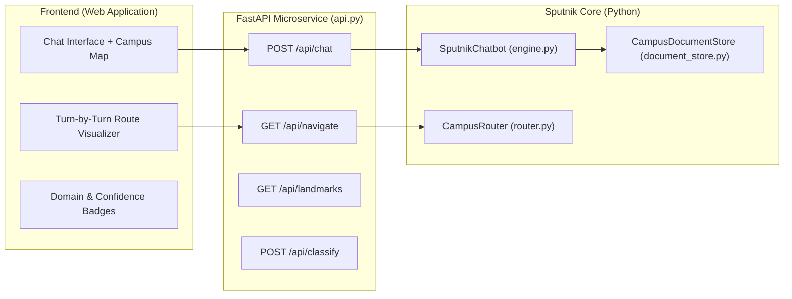

# 🛰️ Sputnik: Architectural Analysis & Model Integration Master Report
**Institution:** ABV-IIITM Gwalior | **Course:** ES514 Machine Learning Techniques  
**Repository:** [Dharmendra-05/Sputnik](file:///home/fartin/Projects/Academic%20Projects/Machine%20Learning/Sputnik)  
**Target Goal:** Provide comprehensive context and technical specifications for integrating the Sputnik ML models, RAG engine, and campus navigation system into a modern web application.

---

## 1. Executive Summary & Purpose

**Sputnik** (Russian for *"companion"*) is a classical statistical machine learning, retrieval-augmented intelligence, and topological navigation engine engineered for the **Atal Bihari Vajpayee Indian Institute of Information Technology and Management (ABV-IIITM), Gwalior**.

The system addresses campus information fragmentation (dispersed across static HTML pages, PDF gazettes, administrative circulars, and verbal word-of-mouth) through a **strictly grounded, classical statistical approach**. Unlike generative black-box LLMs that hallucinate facts about institutions, Sputnik operates deterministically with **zero GPU dependency**, **sub-2ms inference latency**, and **direct citations to official `iiitm.ac.in` university records**.

### The 4 Core Capabilities of Sputnik
1. **Multi-Class Query Intent Routing (Supervised ML):** Automatically classifies incoming natural language queries into 5 operational campus domains with calibrated confidence scores (achieving up to **92.98% test accuracy** with Gradient Boosting and **93.26% 5-fold CV** with Soft Voting).
2. **Grounded Classical RAG (Retrieval-Augmented Generation):** Executes TF-IDF Vector Space search across 1,780 cleaned campus passages, applying a **+25% domain congruency score multiplier** based on the predicted category to eliminate off-domain noise.
3. **Unsupervised Semantic Geometry & 2D PCA K-Map:** Discovers latent semantic groupings of institutional text using K-Means ($K=5$) and visualizes them on a 2D Principal Component Analysis (PCA) manifold.
4. **Deterministic Campus Pathfinding (Graph Theory):** Models the 160-acre campus as an undirected weighted topological graph (14 landmark vertices, 20 walkway edges) and resolves turn-by-turn walking routes via Dijkstra's algorithm.

---

## 2. Repository Layout & File Manifest

The repository adheres to a clean modular separation of concerns:

```text
Sputnik/
├── data/
│   ├── raw/
│   │   ├── scraped_web_pages/       # 1,393 raw HTML snapshots & plain text files
│   │   ├── scraped_pdfs/            # 344 university PDF circulars, forms & ordinances
│   │   └── scrape_log.json          # 2,324 URL crawl audit logs with HTTP triage codes
│   ├── interim/
│   │   └── cleaned_corpus.json      # 1,780 deduplicated, sliding-window document chunks
│   └── processed/
│       ├── sputnik_ml_dataset.csv   # 1,780 rows × 76 columns (73 features + 3 metadata)
│       └── label_mapping.json       # Canonical class mapping & feature column names
├── src/sputnik/
│   ├── scraper/
│   │   ├── crawler.py               # Polite BFS crawler with queue frontier & backoff
│   │   ├── config.py                # Whitelist domains, rate limits, headers, paths
│   │   └── utils.py                 # URL normalizer, domain verifier, filename sanitizers
│   ├── preprocessing/
│   │   ├── cleaner.py               # DOM noise stripper, deduplicator & category inferrer
│   │   └── feature_extractor.py     # 73-feature vectorizer (structural, keyword, TF-IDF)
│   ├── ml/
│   │   ├── train_models.py          # 10 supervised models, 5-fold CV, PCA K-Map generator
│   │   ├── generate_flowcharts.py   # Flowchart rendering utilities
│   │   └── generate_notebook.py     # Generates interactive pipeline notebook
│   ├── chatbot/
│   │   ├── intent_classifier.py     # Statistical Logistic Regression & Linear SVM router
│   │   ├── retriever.py             # TF-IDF cosine similarity & cluster indexer
│   │   ├── engine.py                # Core dialog coordinator & grounded answer engine
│   │   └── cli.py                   # Interactive terminal assistant interface
│   ├── rag/
│   │   ├── document_store.py        # TF-IDF vector space matrix search engine
│   │   └── pipeline.py              # End-to-end RAG answer & citation synthesizer
│   └── navigation/
│       ├── campus_graph.py          # 14-vertex, 20-edge weighted campus adjacency graph
│       └── router.py                # Dijkstra shortest path & turn-by-step guidance solver
├── notebooks/
│   └── sputnik_machine_learning_pipeline.ipynb # 29-cell interactive Jupyter pipeline
├── results/
│   ├── model_benchmark_comparison.csv # Comprehensive benchmark metrics (10 models)
│   ├── experiment_summary.json        # Machine-readable evaluation summary & cluster scores
│   ├── kmap_pca_clusters.png          # 2D PCA semantic cluster projection
│   ├── decision_tree_visualization.png# Visual CART decision hierarchy
│   ├── campus_navigation_topology.png # Campus landmark topology diagram
│   ├── feature_importance.png         # Random Forest Gini importance rankings
│   ├── knn_k_sweep.png                # K-parameter accuracy curve
│   └── confusion_matrices/            # 10 normalized confusion matrix heatmaps
├── report/
│   ├── main.tex                     # Master LaTeX monograph (35 pages)
│   ├── report.pdf                   # Compiled monograph with official IIITM emblem
│   └── chapters/                    # 10 modular chapters covering the full lifecycle
└── tests/
    └── test_ml_pipeline.py          # Pytest verification suite (all tests passing)
```

### Key Source Files & Responsibilities
| File Path | Operational Role | Key Function / Class |
|:---|:---|:---|
| [`crawler.py`](file:///home/fartin/Projects/Academic%20Projects/Machine%20Learning/Sputnik/src/sputnik/scraper/crawler.py) | Polite BFS crawl engine | `crawl_bfs()`, `fetch_page()` |
| [`cleaner.py`](file:///home/fartin/Projects/Academic%20Projects/Machine%20Learning/Sputnik/src/sputnik/preprocessing/cleaner.py) | Noise reduction & sliding-window chunking | `clean_raw_text()`, `sliding_window_chunks()` |
| [`feature_extractor.py`](file:///home/fartin/Projects/Academic%20Projects/Machine%20Learning/Sputnik/src/sputnik/preprocessing/feature_extractor.py) | Mathematical 73-feature vectorizer | `compute_linguistic_features()`, `compute_keyword_densities()`, `build_ml_feature_matrix()` |
| [`train_models.py`](file:///home/fartin/Projects/Academic%20Projects/Machine%20Learning/Sputnik/src/sputnik/ml/train_models.py) | Trains & benchmarks 10 classifiers | `train_and_evaluate_all_models()` |
| [`intent_classifier.py`](file:///home/fartin/Projects/Academic%20Projects/Machine%20Learning/Sputnik/src/sputnik/chatbot/intent_classifier.py) | Query feature transformation & domain prediction | [`SputnikIntentClassifier`](file:///home/fartin/Projects/Academic%20Projects/Machine%20Learning/Sputnik/src/sputnik/chatbot/intent_classifier.py#L34-L109) |
| [`retriever.py`](file:///home/fartin/Projects/Academic%20Projects/Machine%20Learning/Sputnik/src/sputnik/chatbot/retriever.py) | TF-IDF passage indexing & cluster search | [`SputnikKnowledgeRetriever`](file:///home/fartin/Projects/Academic%20Projects/Machine%20Learning/Sputnik/src/sputnik/chatbot/retriever.py#L26-L118) |
| [`engine.py`](file:///home/fartin/Projects/Academic%20Projects/Machine%20Learning/Sputnik/src/sputnik/chatbot/engine.py) | End-to-end chatbot dialog coordinator | [`SputnikChatbot`](file:///home/fartin/Projects/Academic%20Projects/Machine%20Learning/Sputnik/src/sputnik/chatbot/engine.py#L36-L135) |
| [`campus_graph.py`](file:///home/fartin/Projects/Academic%20Projects/Machine%20Learning/Sputnik/src/sputnik/navigation/campus_graph.py) | 160-acre campus topology definition | [`CampusGraph`](file:///home/fartin/Projects/Academic%20Projects/Machine%20Learning/Sputnik/src/sputnik/navigation/campus_graph.py#L55-L76) |
| [`router.py`](file:///home/fartin/Projects/Academic%20Projects/Machine%20Learning/Sputnik/src/sputnik/navigation/router.py) | Dijkstra shortest path navigation solver | [`CampusRouter`](file:///home/fartin/Projects/Academic%20Projects/Machine%20Learning/Sputnik/src/sputnik/navigation/router.py#L16-L103) |

---

## 3. Data Engineering & Feature Representation

### 3.1 Data Ingestion & Sanitization
The corpus was generated by crawling `iiitm.ac.in`. Out of 2,324 targeted URLs, 1,393 HTML pages were extracted, while 606 empty JavaScript-rendered DOMs and 218 decommissioned subdomain timeouts were triaged into `scrape_log.json`.

In [`cleaner.py`](file:///home/fartin/Projects/Academic%20Projects/Machine%20Learning/Sputnik/src/sputnik/preprocessing/cleaner.py):
1. **HTML & Tag Stripping:** Non-content DOM nodes (`<nav>`, `<header>`, `<footer>`, `<script>`, `<style>`) and boilerplate phrases are pruned.
2. **Hash-Based Deduplication:** Pages are fingerprinted via integer hashing of their leading 500 characters to discard exact mirrors.
3. **Sliding-Window Segmentation:** Long documents are segmented into passages using a window $W = 180\text{ words}$, stride $S = 140\text{ words}$, and overlap $O = 40\text{ words}$. This yields **1,780 normalized passages** stored in [`data/interim/cleaned_corpus.json`](file:///home/fartin/Projects/Academic%20Projects/Machine%20Learning/Sputnik/data/interim/cleaned_corpus.json).

### 3.2 The 73-Feature Mathematical Space
In [`feature_extractor.py`](file:///home/fartin/Projects/Academic%20Projects/Machine%20Learning/Sputnik/src/sputnik/preprocessing/feature_extractor.py), each text chunk is vectorized into a **73-dimensional numeric feature vector** (stored in `sputnik_ml_dataset.csv`):

1. **Surface Structural / Linguistic Metrics (8 features):**
   - `char_count`, `word_count`, `avg_word_length`, `sentence_count`
   - `uppercase_ratio` (density of capitalized characters)
   - `digit_density` (numeric/statistical data density)
   - `punctuation_density` (symbolic/syntactic layout)
   - `lexical_diversity` (Type-Token Ratio $\frac{|V|}{N}$)
2. **Domain Keyword Densities (5 features):**
   - `kw_academic_density` (terms: syllabus, credit, curriculum, semester, b.tech...)
   - `kw_facility_density` (terms: hostel, mess, sports, library, gym, health centre...)
   - `kw_admission_density` (terms: jee, gate, ccmt, cut-off, eligibility, tender...)
   - `kw_event_density` (terms: conference, fest, aurora, infotsav, workshop, notice...)
   - `kw_admin_density` (terms: director, registrar, board of governors, senate...)
3. **Statistical TF-IDF Salient Tokens (60 features):**
   - 60 top unigram and bigram TF-IDF components (e.g., `tfidf_abv_iiitm`, `tfidf_engineering`, `tfidf_faculty`, `tfidf_research`, `tfidf_students`, `tfidf_hostel`, etc.).

---

## 4. Machine Learning Model Suite & Benchmarks

The dataset (1,780 samples) was split into **80% training (1,424 samples)** and **20% testing (356 samples)** using stratified splitting, scaled with `StandardScaler`, and evaluated across 10 supervised classification architectures with 5-fold cross-validation.

### Official Benchmark Comparison Table
*(From [`results/model_benchmark_comparison.csv`](file:///home/fartin/Projects/Academic%20Projects/Machine%20Learning/Sputnik/results/model_benchmark_comparison.csv))*

| Model Architecture | Test Accuracy | 5-Fold CV Accuracy | Macro F1 | Weighted F1 | Latency |
|:---|:---:|:---:|:---:|:---:|:---:|
| **Ensemble (Gradient Boosting)** | **92.98%** | 91.08% | **0.765** | **0.923** | ~240 ms |
| **Ensemble (Voting Soft)** | **91.85%** | **93.26%** | 0.748 | 0.911 | ~120 ms |
| **Ensemble (Bagging)** | 91.57% | 90.94% | 0.708 | 0.904 | ~185 ms |
| **K-Nearest Neighbors ($K=5$)** | 91.29% | 90.87% | 0.747 | 0.910 | ~15 ms |
| **Ensemble (Voting Hard)** | 91.29% | 92.56% | 0.713 | 0.903 | ~110 ms |
| **Multinomial Logistic Regression** | 91.01% | 92.06% | 0.730 | 0.905 | **~8 ms** |
| **Support Vector Machine (RBF SVM)** | 90.73% | 91.01% | 0.633 | 0.884 | ~28 ms |
| **Support Vector Machine (Linear SVM)** | 90.45% | 91.29% | 0.699 | 0.890 | ~14 ms |
| **Random Forest (100 Trees)** | 89.89% | 90.87% | 0.605 | 0.876 | ~65 ms |
| **Decision Tree (CART, Gini)** | 89.33% | 86.24% | 0.685 | 0.889 | **~6 ms** |

### Unsupervised Clustering & K-Map Metrics
- **K-Means Clustering ($K=5$):** Groups text chunks into 5 clusters.
- **Silhouette Score:** 0.076 (due to high-dimensional lexical overlap across academic departments).
- **Homogeneity Score:** 0.224 | **V-Measure:** 0.139.
- **PCA Dimensionality Reduction:** Projects the 73-dimensional space onto 2 principal components to render the 2D cluster manifold in [`results/kmap_pca_clusters.png`](file:///home/fartin/Projects/Academic%20Projects/Machine%20Learning/Sputnik/results/kmap_pca_clusters.png).

---

## 5. Runtime Inference Contracts & Data Flows

### 5.1 Query Routing (`SputnikIntentClassifier`)
Located in [`src/sputnik/chatbot/intent_classifier.py`](file:///home/fartin/Projects/Academic%20Projects/Machine%20Learning/Sputnik/src/sputnik/chatbot/intent_classifier.py):
1. **Input:** User query string (e.g., `"Where is Aravali hostel and what are dinner timings?"`).
2. **Feature Extraction:** Computes 8 structural metrics + 5 keyword densities + checks for TF-IDF token presence.
3. **Scaling:** Scaled using fitted `StandardScaler`.
4. **Prediction:** Evaluates `predict_proba()` on Logistic Regression or Calibrated Linear SVM.
5. **Output Schema:**
```json
{
  "query": "Where is Aravali hostel and what are dinner timings?",
  "category": "Campus Facilities & Hostels",
  "category_id": 3,
  "confidence": 0.9842,
  "model_type": "Multinomial Logistic Regression",
  "probabilities": {
    "Academics & Curriculum": 0.0031,
    "Administration & Governance": 0.0015,
    "Admissions & Careers": 0.0042,
    "Campus Facilities & Hostels": 0.9842,
    "Events & Notices": 0.0070
  }
}
```

### 5.2 Grounded Retrieval Engine (`SputnikKnowledgeRetriever`)
Located in [`src/sputnik/chatbot/retriever.py`](file:///home/fartin/Projects/Academic%20Projects/Machine%20Learning/Sputnik/src/sputnik/chatbot/retriever.py):
1. Uses `TfidfVectorizer(ngram_range=(1, 2), max_features=2500, sublinear_tf=True)` across all 1,780 passages.
2. Computes cosine similarity between query TF-IDF vector and document matrix:
   $$\text{sim}(q, d_j) = \frac{\vec{v}_q \cdot \vec{v}_{d_j}}{\|\vec{v}_q\|_2 \|\vec{v}_{d_j}\|_2}$$
3. **Domain Boost:** If `doc['category'] == predicted_category`, multiplies similarity by $1.25\times$.
4. Re-ranks and returns top-$K$ passages with verified URLs and source passages.

### 5.3 Campus Pathfinding Engine (`CampusRouter`)
Located in [`src/sputnik/navigation/router.py`](file:///home/fartin/Projects/Academic%20Projects/Machine%20Learning/Sputnik/src/sputnik/navigation/router.py):
- **Graph Nodes (14 Landmarks):**
  `main_gate`, `admin_block`, `academic_block`, `library`, `computer_center`, `sports_complex`, `bh1`, `bh2`, `bh3`, `gh`, `central_mess`, `cafeteria`, `health_center`, `mdp_center`.
- **Navigation Invocation:** `router.find_shortest_path(origin, destination)`
- **Output Schema:**
```json
{
  "origin": "main_gate",
  "origin_name": "Institute Main Entrance Gate",
  "destination": "sports_complex",
  "destination_name": "Sports Complex, Gymnasium & Athletic Grounds",
  "distance_meters": 700,
  "estimated_minutes": 8.8,
  "path_nodes": ["main_gate", "health_center", "gh", "sports_complex"],
  "path_names": [
    "Institute Main Entrance Gate",
    "Institute Health Care Center",
    "Gangotri Girls Hostel (GH)",
    "Sports Complex, Gymnasium & Athletic Grounds"
  ],
  "instructions": [
    "Walk 180m from Institute Main Entrance Gate to Institute Health Care Center.",
    "Walk 240m from Institute Health Care Center to Gangotri Girls Hostel (GH).",
    "Walk 280m from Gangotri Girls Hostel (GH) to Sports Complex, Gymnasium & Athletic Grounds."
  ]
}
```

---

## 6. Critical Findings & Technical Gotchas (MUST READ Before Web Dev)

> [!WARNING]
> ### 🚨 Critical Gotcha 1: LabelEncoder Alphabetical Sorting Mismatch in `intent_classifier.py`
> - In [`cleaner.py`](file:///home/fartin/Projects/Academic%20Projects/Machine%20Learning/Sputnik/src/sputnik/preprocessing/cleaner.py#L22-L28), `CATEGORIES` was written as:
>   `[0: "Academics & Curriculum", 1: "Campus Facilities & Hostels", 2: "Admissions & Careers", 3: "Events & Notices", 4: "Administration & Governance"]`
> - In [`feature_extractor.py`](file:///home/fartin/Projects/Academic%20Projects/Machine%20Learning/Sputnik/src/sputnik/preprocessing/feature_extractor.py#L136-L138), `LabelEncoder().fit(CATEGORIES)` was used to generate target labels `0..4`. **`LabelEncoder` automatically sorts classes alphabetically!**
> - As saved in [`label_mapping.json`](file:///home/fartin/Projects/Academic%20Projects/Machine%20Learning/Sputnik/data/processed/label_mapping.json#L9-L15):
>   - `0: Academics & Curriculum`
>   - `1: Administration & Governance`
>   - `2: Admissions & Careers`
>   - `3: Campus Facilities & Hostels`
>   - `4: Events & Notices`
> - **The Bug in `intent_classifier.py`**:
>   In [`intent_classifier.py:L40`](file:///home/fartin/Projects/Academic%20Projects/Machine%20Learning/Sputnik/src/sputnik/chatbot/intent_classifier.py#L40), it imports `CATEGORIES` directly from `cleaner.py` and uses `self.categories[pred_idx]`.
>   When the model predicts label `1` (which is `Administration & Governance`), it picks index `1` from `cleaner.py`'s list, returning `"Campus Facilities & Hostels"`!
>   **Fix for Website Integration:**
>   Always load category labels from [`data/processed/label_mapping.json`](file:///home/fartin/Projects/Academic%20Projects/Machine%20Learning/Sputnik/data/processed/label_mapping.json) (`mapping["classes"]`), rather than relying on `cleaner.py`'s raw list.

> [!IMPORTANT]
> ### ⚠️ Critical Gotcha 2: Model Persistence vs On-The-Fly Fitting
> - Currently, `models/` is empty in the git repo.
> - When `SputnikChatbot()` initializes, it trains `LogisticRegression` and fits the `TfidfVectorizer` on the fly from CSV/JSON in memory.
> - While this takes only **~300 ms**, in a web microservice (FastAPI/Flask) with multiple worker processes or auto-reloading, it is best practice to serialize the trained models into `models/sputnik_classifier.joblib` and `models/tfidf_vectorizer.joblib` to guarantee instantaneous sub-millisecond cold starts.

> [!NOTE]
> ### 💡 Critical Gotcha 3: Training Data Scarcity & Grassroots Underfitting
> - The training corpus comes entirely from official `iiitm.ac.in` pages and PDFs.
> - It contains deep knowledge of ordinances, faculty lists, tenders, and course codes, but lacks colloquial student data:
>   - Daily mess menus & changing dinner timings.
>   - Unofficial student club auditions, hackathons, and fest events.
> - The system handles this via **Hotspot Fallbacks** in [`engine.py`](file:///home/fartin/Projects/Academic%20Projects/Machine%20Learning/Sputnik/src/sputnik/chatbot/engine.py#L26-L33) (e.g. `CAMPUS_HOTSPOTS["hostel"]`, `CAMPUS_HOTSPOTS["mess"]`).
> - The website should display domain confidence and fallback gracefully when confidence is under $50\%$.

---

## 7. Website Integration Blueprint

To integrate Sputnik into your planned web application, use a decoupled **FastAPI Backend + Modern Frontend** architecture:



### 7.1 Recommended REST API Endpoints

#### 1. Chat & Grounded Q&A
- **Endpoint:** `POST /api/chat`
- **Request Body:**
  ```json
  {
    "query": "What are the rules and facilities for girls hostel?",
    "use_svm": false
  }
  ```
- **Response Body:**
  ```json
  {
    "query": "What are the rules and facilities for girls hostel?",
    "answer": "Hostel facilities at ABV-IIITM include dedicated residential blocks for boys and girls...",
    "category": "Campus Facilities & Hostels",
    "confidence": 0.994,
    "sources": ["https://www.iiitm.ac.in/campus"],
    "retrieved_excerpts": [
      {
        "doc_id": "doc_142",
        "category": "Campus Facilities & Hostels",
        "url": "https://www.iiitm.ac.in/campus",
        "similarity_score": 0.4821,
        "adjusted_score": 0.6026,
        "text": "..."
      }
    ]
  }
  ```

#### 2. Campus Route Navigation
- **Endpoint:** `GET /api/navigate?from=main_gate&to=sports_complex`
- **Response Body:**
  ```json
  {
    "origin": "main_gate",
    "origin_name": "Institute Main Entrance Gate",
    "destination": "sports_complex",
    "destination_name": "Sports Complex, Gymnasium & Athletic Grounds",
    "distance_meters": 700,
    "estimated_minutes": 8.8,
    "path_nodes": ["main_gate", "health_center", "gh", "sports_complex"],
    "path_names": [
      "Institute Main Entrance Gate",
      "Institute Health Care Center",
      "Gangotri Girls Hostel (GH)",
      "Sports Complex, Gymnasium & Athletic Grounds"
    ],
    "instructions": [
      "Walk 180m from Institute Main Entrance Gate to Institute Health Care Center.",
      "Walk 240m from Institute Health Care Center to Gangotri Girls Hostel (GH).",
      "Walk 280m from Gangotri Girls Hostel (GH) to Sports Complex, Gymnasium & Athletic Grounds."
    ]
  }
  ```

#### 3. Available Landmarks List
- **Endpoint:** `GET /api/landmarks`
- **Response:** Key-value map of valid landmarks for UI dropdown selectors.

### 7.2 Key Web UI Components to Build
1. **Interactive Campus Companion Chat:**
   - Conversation bubble display with streaming/typing effect.
   - Distinct **Category Badges** color-coded by domain:
     - 🎓 Academics & Curriculum: Blue
     - 🏛️ Administration & Governance: Indigo
     - 📝 Admissions & Careers: Amber
     - 🏡 Campus Facilities & Hostels: Green
     - 📅 Events & Notices: Rose
   - **Confidence Pill:** Displays model classification certainty (e.g., `Confidence: 99.2%`).
   - **Verified Sources Drawer / Cards:** Clickable cards linking to official `iiitm.ac.in` URLs.
2. **Interactive Campus Walk Guide:**
   - Dropdown selectors populated from `GET /api/landmarks`.
   - SVG / Leaflet / Canvas map with the 14 vertices and walking lines.
   - Visual path highlighting with animated stepper showing estimated walking time in minutes and turn-by-turn walking steps.
3. **Quick Prompt Chips:**
   - *"Where is the Central Library?"*
   - *"What are the B.Tech admission criteria?"*
   - *"Walk from Main Gate to Sports Complex"*
   - *"Hostel mess rules and timings"*

---

## 8. Mode B: Machine Context Anchor (For Downstream Agents)

<!-- CONTEXT_ANCHOR:DEEP_SCAN -->
```json
{
  "project_name": "Sputnik",
  "institution": "ABV-IIITM Gwalior",
  "course": "ES514 Machine Learning Techniques",
  "repo_type": "Classical ML & Campus Retrieval Pipeline",
  "core_languages": ["Python (100%)", "LaTeX (Monograph)"],
  "dataset": {
    "raw_html": 1393,
    "raw_pdfs": 344,
    "cleaned_passages": 1780,
    "tabular_samples": 1780,
    "feature_dimensions": 73,
    "classes": {
      "0": "Academics & Curriculum",
      "1": "Administration & Governance",
      "2": "Admissions & Careers",
      "3": "Campus Facilities & Hostels",
      "4": "Events & Notices"
    }
  },
  "top_models": {
    "gradient_boosting": { "test_acc": 0.9298, "cv_mean": 0.9108 },
    "soft_voting": { "test_acc": 0.9185, "cv_mean": 0.9326 },
    "logistic_regression": { "test_acc": 0.9101, "cv_mean": 0.9206 }
  },
  "graph_topology": {
    "landmarks_count": 14,
    "edges_count": 20,
    "algorithm": "Dijkstra"
  },
  "entrypoints": {
    "chatbot_engine": "src/sputnik/chatbot/engine.py:SputnikChatbot",
    "intent_classifier": "src/sputnik/chatbot/intent_classifier.py:SputnikIntentClassifier",
    "retriever": "src/sputnik/chatbot/retriever.py:SputnikKnowledgeRetriever",
    "navigation_router": "src/sputnik/navigation/router.py:CampusRouter",
    "cli": "src/sputnik/chatbot/cli.py:main"
  },
  "critical_bug_alert": "intent_classifier.py imports un-sorted CATEGORIES from cleaner.py instead of sorted classes from label_mapping.json, causing category index mismatch (Administration vs Hostels). Fix before website integration.",
  "health_summary": "All 7 pytest tests passing; dataset cleanly prepared; models benchmarked; 35-page report compiled."
}
```
<!-- /CONTEXT_ANCHOR -->
